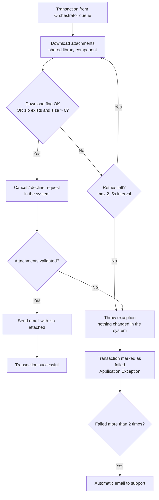
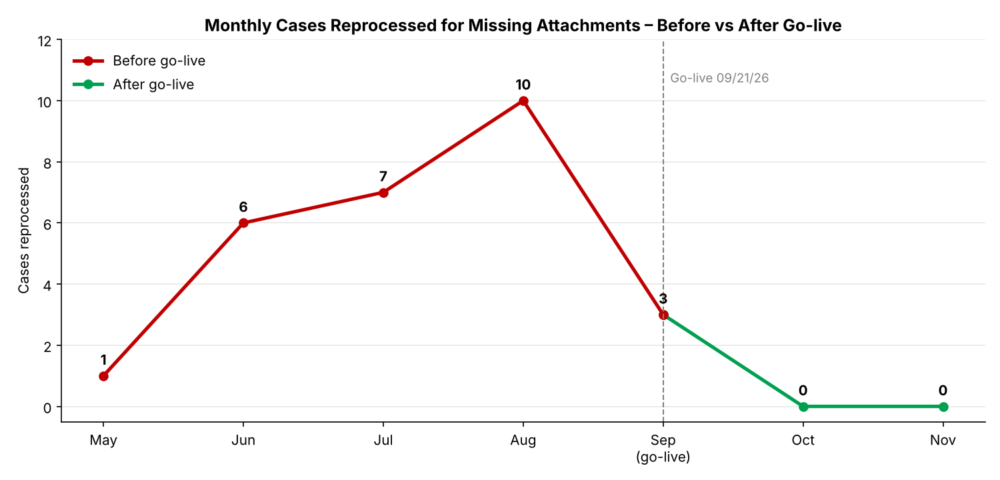

# Automatic Retries for Emails Missing Attachments

**Technology:** UiPath

## Problem
Two production automations (Process A and Process B) sent emails with or without their attachments by design. When the attachment download failed, the email went out incomplete, and business users had to request case reprocessing almost every week through tickets and emails.

## Solution
An enhancement to both processes that:
- Allows more time for the attachment download
- Validates that all attachments are present before sending
- Never sends an email without its attachments
- Automatically retries the download on failure

Go-live: **09/21/26**

## How It Works
- **Reusable component:** the attachment download lives in a shared library and returns a success flag, so the same fix was applied to both Process A and Process B without duplicating code.
- **Double validation:** a download is only considered successful if the component reports success OR the zip file exists and is not empty, avoiding false negatives.
- **Retry Scope:** up to 2 retries with a 5-second interval, using a Check True condition on the validation result.
- **Safe ordering:** attachments are downloaded and validated before any irreversible action (declining the request or sending the email), so a failed case is left untouched and can be reprocessed.
- **Hard gate:** the email is sent only when attachments are validated; otherwise an exception is thrown. No email ever goes out without its attachments.
- **Failure handling:** failed transactions are marked as Application Exceptions in Orchestrator, and support is notified automatically if the same transaction fails more than 2 times.

## Logic

## Benchmark
Reprocessing requests were tracked from the start of the benchmark period (05/28/26) through go-live, and from go-live onward, to validate the impact with real data.

| Metric | Before (3.8 months) | After (2.1 months) | Reduction |
|---|---|---|---|
| Reprocessing requests | 17 | 0 | 100% |
| Cases reprocessed | 27 | 0 | 100% |
| Requests per month | 4.5 | 0 | 100% |
| Manual effort (man-minutes) | 271 | 0 | 100% |
| Manual hours per year (projected) | 14.2 | 0 | 100% |
| Days of delay per year (projected) | 85 | 0 | 100% |

Zero requests since go-live is statistically significant: the probability that this result is due to chance is below 5%.

The full request log and calculations are available in [Reprocessing_Requests_Benchmark.xlsx](Reprocessing_Requests_Benchmark.xlsx).

## Results
- 100% reduction in missing-attachment reprocessing requests
- No reprocessing requests since go-live on 09/21/26
- One reusable fix applied to two production processes
- Less manual work for the support team and no delays for business users

*Process names, ticket numbers and case identifiers have been replaced with generic values to protect client confidentiality. Counts, dates and results reflect the real data.*
