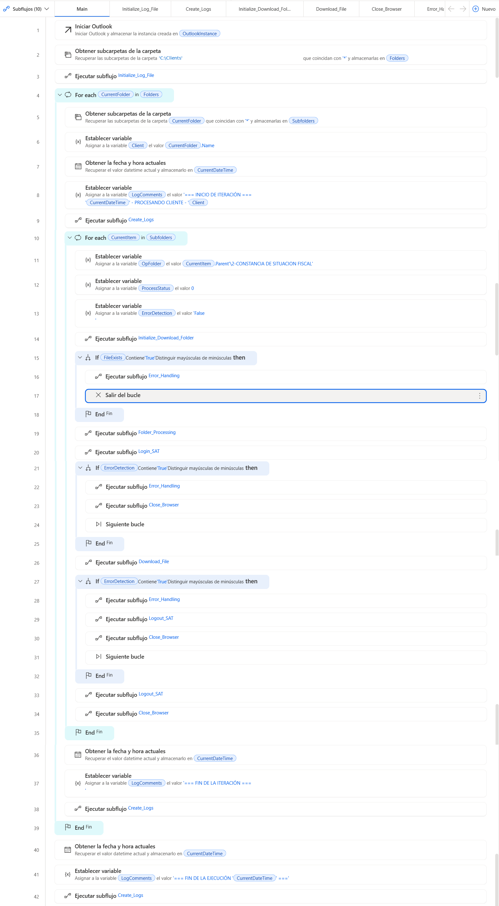
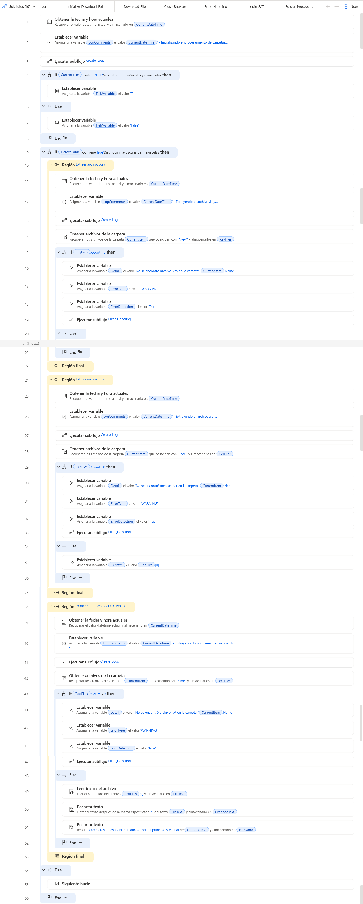
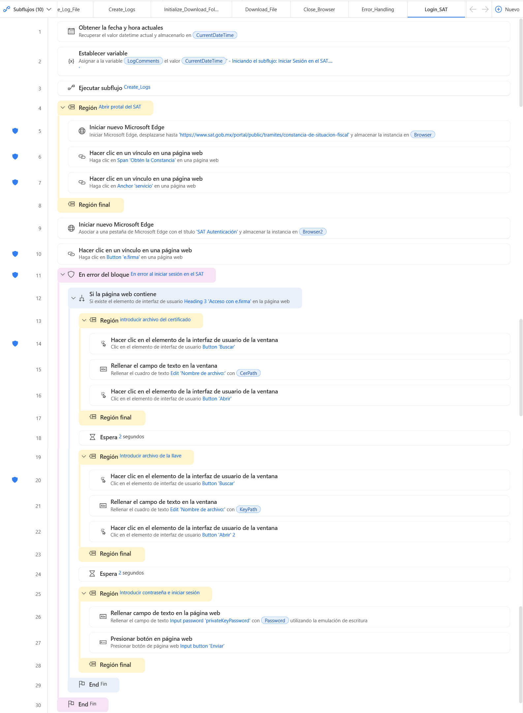

# Descarga automática de documentos del SAT: Constancia de Situación Fiscal y Opinión de Cumplimiento

*Two Power Automate Desktop flows that sign in to Mexico's tax authority (SAT) portal with each client's e.firma, download their Tax Status Certificate (CSF) and Tax Compliance Opinion, and file them automatically by document type, year and month.*

**Tecnología:** Power Automate Desktop

## Problema
Los contadores descargaban manualmente, cada mes, la Constancia de Situación Fiscal y la Opinión de Cumplimiento de cada cliente desde el portal del SAT, y además creaban a mano las carpetas por año para organizarlas. Es una tarea repetitiva, lenta y propensa a errores cuando se manejan muchos clientes.

## Solución
Dos flujos con la misma arquitectura:
- **CSF:** descarga la Constancia de Situación Fiscal
- **Opinión:** descarga la Opinión del Cumplimiento de Obligaciones Fiscales

Ambos recorren una carpeta de clientes, validan los archivos de e.firma de cada uno, acceden al portal del SAT, descargan el documento y lo guardan organizado automáticamente por tipo de documento y año, sin crear carpetas manualmente. La única diferencia entre ellos es la página del SAT a la que acceden; el resto de la lógica (validación, login, logs, manejo de errores) es la misma, lo que facilita mantener y extender la solución a otros documentos.

## Cómo funciona
1. Inicia Outlook y prepara el archivo de log de la ejecución
2. Lee la carpeta principal de clientes, que contiene una carpeta por cliente
3. Para cada cliente:
   - Registra en el log el inicio del proceso con fecha y hora
   - Prepara la carpeta de descarga; si el documento del mes ya existe, lo registra como INFO y pasa al siguiente cliente para no duplicarlo
   - Valida la carpeta de e.firma del cliente (ver abajo)
   - Inicia sesión en el portal del SAT con la e.firma del cliente
   - Descarga el documento y lo guarda en la carpeta del año actual con el formato **MM-MES-CLIENTE-DOCUMENTO.pdf**
   - Cierra la sesión del SAT y el navegador
   - Registra en el log el fin del proceso del cliente
4. Al terminar todos los clientes, registra en el log el fin de la ejecución

Cada flujo está dividido en **10 subflujos** reutilizables (logs, carpetas, validación de e.firma, login, descarga, logout, cierre de navegador y manejo de errores), lo que facilita su mantenimiento.

### Validación de la e.firma
1. Identifica la carpeta de e.firma del cliente (su nombre contiene "FIEL"); las demás subcarpetas se omiten
2. Busca la llave privada (.key), el certificado (.cer) y el archivo .txt con la contraseña
3. Si falta cualquiera de los tres, registra un WARNING con el detalle de qué archivo falta y en qué carpeta, y el cliente pasa al manejo de errores
4. Si todo está completo, guarda las rutas de los archivos y extrae la contraseña del .txt para usarlas en el inicio de sesión

### Inicio de sesión en el SAT
1. Abre el portal del SAT en la sección del documento correspondiente
2. Selecciona el acceso con e.firma
3. Valida que la página de acceso con e.firma esté cargada antes de continuar
4. Carga el certificado (.cer) y la llave privada (.key) del cliente
5. Introduce la contraseña de la llave e inicia sesión

Las rutas del certificado, la llave y la contraseña se manejan con variables por cliente; ningún dato de acceso está escrito directamente en el flujo.

## Estructura de carpetas
```
Clientes/
├── Cliente A/
│   ├── FIEL/
│   │   ├── certificado.cer
│   │   ├── llave.key
│   │   └── contraseña.txt
│   ├── CSF/
│   │   ├── 2025/
│   │   │   └── 12-DIC-CLIENTE A-CONSTANCIA DE SITUACION FISCAL.pdf
│   │   └── 2026/
│   │       └── 03-MAR-CLIENTE A-CONSTANCIA DE SITUACION FISCAL.pdf
│   └── OPINION/
│       └── 2026/
│           └── 05-MAY-CLIENTE A-OPINION.pdf
└── Cliente B/
    └── ...
```

Cada documento, mes y año se organiza solo: el flujo crea las carpetas que falten y nombra los archivos automáticamente. El prefijo numérico del mes mantiene los archivos ordenados cronológicamente.

## Manejo de errores
- Validación previa de los archivos de e.firma: si falta la llave, el certificado o la contraseña, se registra un WARNING con el detalle antes de intentar el login
- Detección de duplicados: si el documento del mes ya existe, se registra como INFO y se omite el cliente
- El inicio de sesión está protegido con un bloque de manejo de errores (On block error); cualquier falla en el portal se captura sin detener el flujo
- Antes de cargar los archivos, el flujo valida que la página de acceso con e.firma esté disponible
- Si falla el login, se ejecuta el subflujo de manejo de errores, se cierra el navegador y el flujo continúa con el siguiente cliente
- Si falla la descarga, se registra como CRITICAL, se cierra la sesión del SAT y el navegador, y se continúa con el siguiente cliente
- Un cliente con error nunca detiene el proceso de los demás

## Ejemplo de log
Cada ejecución genera un log organizado por año y mes, con fecha y hora de cada paso, eventos clasificados por nivel (INFO, WARNING, CRITICAL) y el cliente afectado.

Ver [log-ejemplo.txt](log-ejemplo.txt) (ejecución del flujo de Opinión, nombres de clientes reemplazados).

## Resultado
- Presentado a contadores como solución para su operación mensual
- Dos documentos fiscales por cliente descargados y organizados sin intervención manual
- Elimina la descarga manual y la creación de carpetas mes con mes y año con año

## Mejoras futuras
- Guardar la contraseña de la e.firma en el Administrador de credenciales de Windows o en un archivo cifrado, en lugar de un .txt en la carpeta del cliente
- Unificar ambos flujos en uno solo parametrizado por tipo de documento
- Enviar al final de la ejecución un resumen por correo con los clientes procesados y los que tuvieron error

## Capturas

**Flujo principal**


**Validación de los archivos de e.firma**


**Inicio de sesión en el SAT con e.firma**


*Los archivos de e.firma, rutas y datos de clientes no se incluyen en este repositorio por seguridad.*
