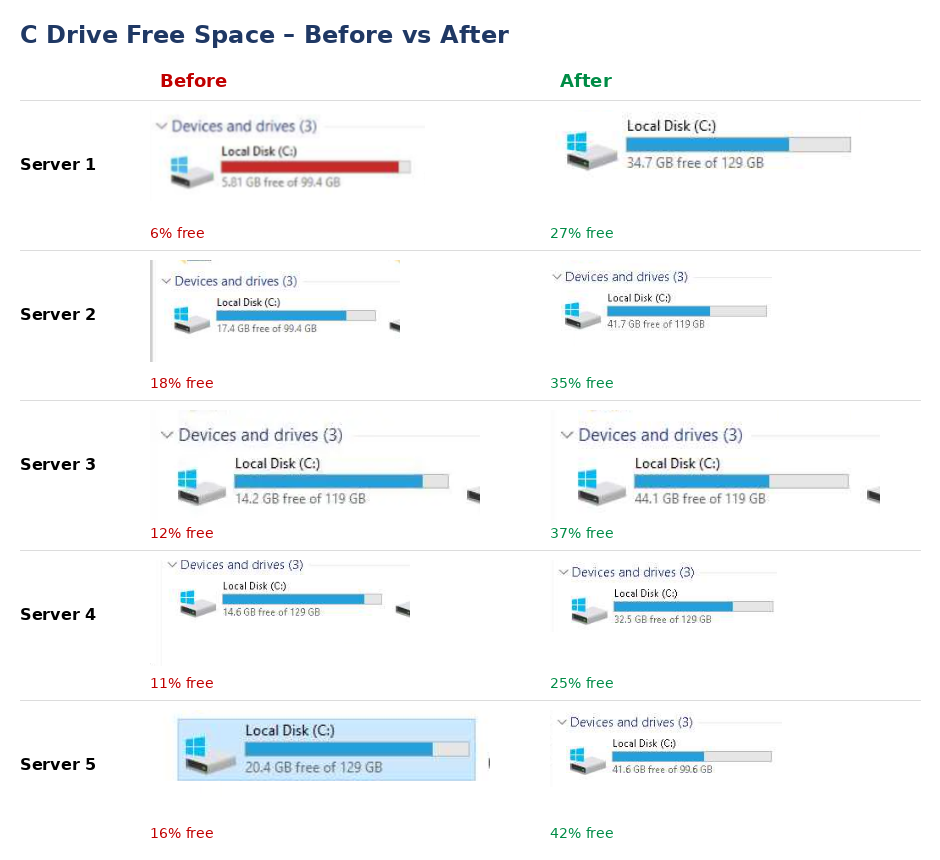

# Root-Cause Fix for Low Disk Space on RPA Servers

**Technology:** UiPath (cleanup and monitoring processes) · Outlook / Exchange configuration · Windows Server

## Problem
Multiple RPA bot servers repeatedly ran low on C drive space, triggering recurring alerts from the infrastructure team and putting automated processes at risk of failure. Each occurrence required manual intervention.

## Analysis and Solution

**1. First mitigation: automated cache cleanup**
Analysis found years of accumulated cache and temporary files (Outlook, browser and NuGet package cache). I built an automated process to safely remove these disposable files on a recurring basis. It reclaimed up to 5 GB per server, but monitoring showed the space filled up again shortly after each cycle, so this was a mitigation, not a fix.

**2. Root cause: Outlook offline mailbox cache**
Further investigation identified the Outlook .ost file (offline mailbox cache) as the main contributor. The bot accounts were configured to keep 6 months of mail offline, duplicating months of mailbox content locally on every server.

**3. Tested and applied the fix**
- Reduced "Mail to keep offline" from 6 months to 1 week and compacted the .ost file
- Monitored for one week with no impact on any automated process; all email content remained accessible
- Rolled the change out to all servers, for both primary and secondary bot accounts

**4. Prevention: monitoring**
A new internal monitoring process sends a notification when C drive free space drops below 30% of total capacity.

## Results

| Server | Free space before | Free space after |
|---|---|---|
| Server 1 | 5.81 GB (6%) | 34.7 GB (27%) |
| Server 2 | 17.4 GB (18%) | 41.7 GB (35%) |
| Server 3 | 14.2 GB (12%) | 44.1 GB (37%) |
| Server 4 | 14.6 GB (11%) | 32.5 GB (25%) |
| Server 5 | 20.4 GB (16%) | 41.6 GB (42%) |

- Free space increased from as low as 6% to between 25% and 42% across 5 production servers
- Up to 30 GB of additional free space per server
- Permanent fix at the root cause instead of recurring manual cleanups
- Fewer alerts from the infrastructure team and lower risk of process failures

The full issue record, with configuration steps and before/after evidence for each server, is available in [RPA_Server_Disk_Space_Issue_Record.pdf](RPA_Server_Disk_Space_Issue_Record.pdf).

## Key Takeaway
The first fix treated the symptom. Monitoring its results showed it wasn't enough, which led to finding and fixing the real cause with a low-risk, tested configuration change.

*Server names, account names, email addresses and mailbox names have been replaced with generic values to protect client confidentiality. Disk space figures and results reflect the real data. The cleanup and monitoring process code is owned by my employer; this page documents the case.*
